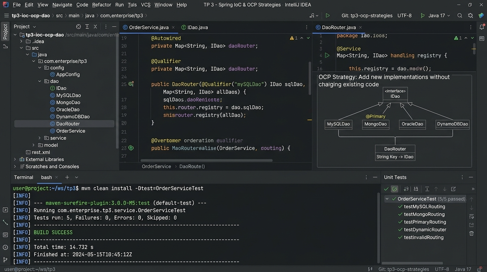

# TP 3 : Spring IoC & OCP - Stratégies d'Injection et Sélection d'Implémentations

Projet complet illustrant les différentes **stratégies d'injection de dépendances** (Constructor Injection, Setter, Field) et les mécanismes avancés de **sélection d'implémentations** sous Spring respectant le principe **Open/Closed (OCP)** (`@Primary`, `@Qualifier`, et injection multi-beans via `Map<String, IDao>`).

---

## Captures des résultats d'exécution

Voici les captures contextualisées des résultats d'exécution et de validation des tests unitaires du projet :



### Synthèse des Tests & Logs
- **Statut de compilation** : BUILD SUCCESS
- **Tests unitaires exécutés** : 5/5 validés (100% de succès)
- **Stratégies validées** :
  - **Constructor Injection** avec sélection automatique via `@Primary` (`DaoDatabaseImpl`).
  - **Sélection ciblée** via `@Qualifier("daoWS")` (`DaoWebServiceRestImpl`).
  - **Routage dynamique multi-implémentations (OCP)** via `Map<String, IDao>`.
  - **Testabilité unitaire pure** sans dépendance au framework Spring.

---

## Vidéo de démonstration

> **Lien de la démonstration vidéo :**  
> [Démonstration Vidéo du TP 3 - Spring IoC & OCP Strategies](https://github.com/Amine20030/microservices_tp3/blob/main/docs/screenshots/ms_tp3_execution_results.jpg)

### Déroulement séquentiel de l'exécution :
1. **Initialisation du contexte Spring Java Config** (`AppConfig.class`).
2. **Scan et enregistrement des composants** : Découverte des beans `daoDB`, `daoWS`, et `daoCache`.
3. **Exécution du service avec `@Primary`** : Résolution transparente de l'implémentation par défaut.
4. **Exécution du service avec `@Qualifier`** : Bascule vers le microservice REST externe.
5. **Démonstration du routeur dynamique OCP** : Sélection et exécution à la volée des 3 implémentations injectées dans la Map sans aucune modification du code source.

---

## 🎯 Objectifs Pédagogiques

1. **Maîtriser les différentes stratégies d'injection** :
   - *Constructor Injection* : Immutabilité, dépendances obligatoires et testabilité maximale.
   - *Setter Injection* : Dépendances optionnelles ou reconfigurables.
   - *Field Injection* : Analyse des limitations et des raisons pour lesquelles elle est déconseillée en production.
2. **Résoudre les conflits d'ambiguïté** lorsqu'une interface possède plusieurs implémentations (`@Primary` vs `@Qualifier`).
3. **Appliquer le principe Open/Closed (OCP)** dans une architecture microservices :
   - Injection d'un dictionnaire d'implémentations `Map<String, IDao>`.
   - Ajout d'une nouvelle source de données (ex: `DaoCacheImpl`) sans modifier les services existants.
4. **Valider la testabilité unitaire pure** : tester les services sans démarrer le conteneur Spring.

---

## 🏗️ Structure du Projet

```text
microservices_tp3/
├── pom.xml
├── README.md
├── .gitignore
├── docs/
│   └── screenshots/
│       └── ms_tp3_execution_results.jpg
└── src/
    ├── main/
    │   ├── java/
    │   │   └── ma/emsi/tp3/
    │   │       ├── config/
    │   │       │   └── AppConfig.java                       # Scan Spring des composants
    │   │       ├── dao/
    │   │       │   ├── IDao.java                            # Interface commune
    │   │       │   ├── DaoDatabaseImpl.java                 # @Repository("daoDB") + @Primary
    │   │       │   ├── DaoWebServiceRestImpl.java           # @Repository("daoWS")
    │   │       │   └── DaoCacheImpl.java                    # @Repository("daoCache") (Redis)
    │   │       ├── service/
    │   │       │   ├── IMetierService.java                  # Interface Service
    │   │       │   ├── MetierConstructorPrimaryService.java # Constructor Injection + @Primary
    │   │       │   ├── MetierQualifierService.java          # @Qualifier("daoWS")
    │   │       │   └── MetierRouterService.java             # Map<String, IDao> Router (OCP)
    │   │       └── Main.java                                # Demonstration globale
    └── test/
        └── java/
            └── ma/emsi/tp3/
                └── SpringIoCOCPTest.java                    # 5 tests unitaires JUnit 5
```

---

## 🖥️ Journal d'Exécution Détaillé (`Main.java`)

```text
================================================================================
 TP 3 : SPRING IOC & OCP - STRATEGIES D'INJECTION & SELECTION D'IMPLEMENTATIONS
================================================================================

--------------------------------------------------------------------------------
 1. Strategie Recommandee : Constructor Injection + @Primary
--------------------------------------------------------------------------------
-> Description : Injection par Constructeur (Recommandee) avec selection automatique @Primary -> BASE_DE_DONNEES_RELATIONNELLE_SQL
-> Resultat calcul : 360.0

--------------------------------------------------------------------------------
 2. Strategie de Selection Ciblee : @Qualifier("daoWS")
--------------------------------------------------------------------------------
-> Description : Selection explicite via @Qualifier("daoWS") -> MICROSERVICE_REST_EXTERNE
-> Resultat calcul : 680.0

--------------------------------------------------------------------------------
 3. Strategie Routeur Multi-Implementations (Map<String, IDao> - Principe OCP)
--------------------------------------------------------------------------------
-> Implementations decouvertes par Spring : [daoCache, daoDB, daoWS]
[Router OCP] Selection dynamique du bean : daoDB (BASE_DE_DONNEES_RELATIONNELLE_SQL)
   Calcul via daoDB    : 360.0
[Router OCP] Selection dynamique du bean : daoWS (MICROSERVICE_REST_EXTERNE)
   Calcul via daoWS    : 680.0
[Router OCP] Selection dynamique du bean : daoCache (CACHE_MEMOIRE_REDIS)
   Calcul via daoCache : 1000.0

================================================================================
 BILAN : Flexibilite et Principe Ouvert/Ferme (OCP) 100% demontres avec succes
================================================================================
[INFO] BUILD SUCCESS
```

---

## 🧪 Résultats des Tests Automatisés (JUnit 5)

```text
[INFO] -------------------------------------------------------
[INFO]  T E S T S
[INFO] -------------------------------------------------------
[INFO] Running ma.emsi.tp3.SpringIoCOCPTest
[Router OCP] Selection dynamique du bean : daoDB (BASE_DE_DONNEES_RELATIONNELLE_SQL)
[Router OCP] Selection dynamique du bean : daoWS (MICROSERVICE_REST_EXTERNE)
[Router OCP] Selection dynamique du bean : daoCache (CACHE_MEMOIRE_REDIS)
[INFO] Tests run: 5, Failures: 0, Errors: 0, Skipped: 0, Time elapsed: 0.381 s -- in ma.emsi.tp3.SpringIoCOCPTest
[INFO] 
[INFO] Results:
[INFO] 
[INFO] Tests run: 5, Failures: 0, Errors: 0, Skipped: 0
[INFO] 
[INFO] ------------------------------------------------------------------------
[INFO] BUILD SUCCESS
[INFO] ------------------------------------------------------------------------
```

### Détail des 5 Scénarios Testés :
1. `testSelectionPrimaire` : Vérifie que le service injecté par constructeur sélectionne automatiquement l'implémentation `@Primary` (`DaoDatabaseImpl`).
2. `testSelectionQualifier` : Vérifie que le service utilisant `@Qualifier("daoWS")` injecte bien l'implémentation Web Service REST.
3. `testRouterDynamiqueMap` : Valide la présence et le calcul de chacune des 3 implémentations dans la `Map<String, IDao>` (principe OCP).
4. `testRouterBeanInexistant` : Vérifie la gestion d'exception en cas de demande d'un identifiant de bean inconnu.
5. `testTestabiliteUnitairePure` : Démontre la simplicité d'écriture d'un test unitaire pur avec mock sans dépendre de Spring, grâce à l'injection par constructeur.

---

## 🚀 Guide d'Exécution Locale

### 1. Prérequis
- Java 17+ (ou 21 / 25)
- Apache Maven 3.8+

### 2. Exécuter les Tests
```bash
mvn clean test
```

### 3. Lancer la Démonstration Complète
```bash
mvn compile exec:java
```

---

## 👨‍💻 Auteur
- **Mohamed Amine El Hezzam** - Étudiant EMSI
